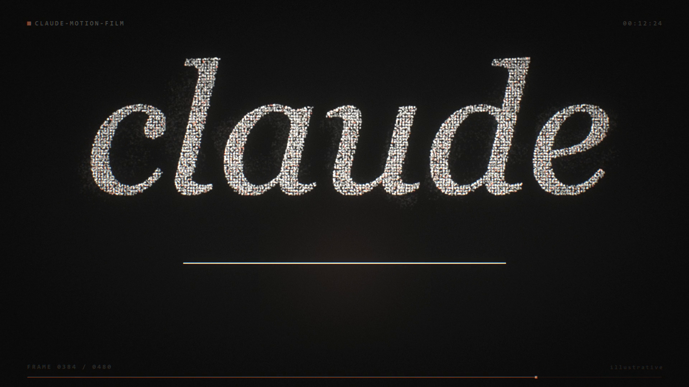
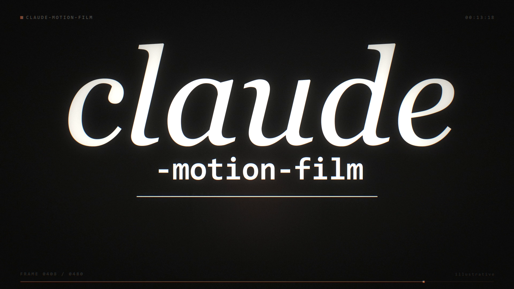
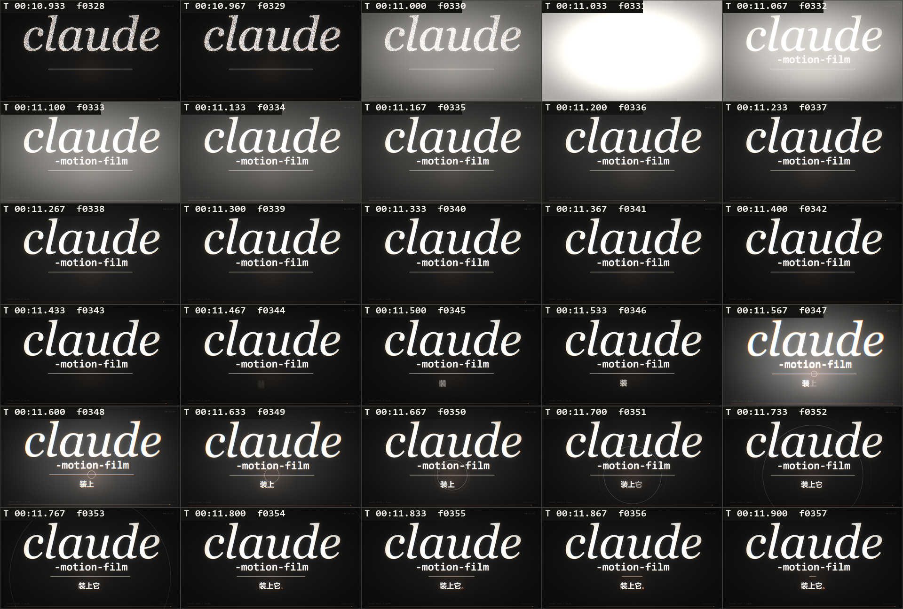
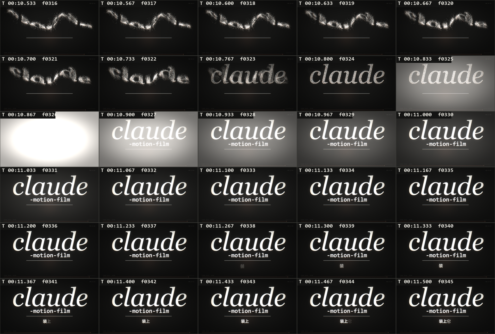

# claude-motion-film

**给编码 Agent 用的动效设计技能。** 给它一个主题，它还你一支短片——
暖近黑底、一个赤陶橙、一个母题承担所有角色、零硬切、120 BPM 时刻表、
全合成配乐。

`v0.1.0 (beta)` · 1920×1080 · 30 fps · Agent 创作，代码渲染

[English](README.md) · **简体中文**



---

## 这到底是什么

它不是视频模板。它是一套**约束**——风格卡、导演任务书、制作流水线和验收门槛——
让 Agent 交出能进作品集的动效设计，而不是会动的 PPT。

真正起作用的只有一条：**一个母题，同时充当光标、标点、图标、转场和数据标记**，
以及**零硬切**——所有段落边界都是同一个物件在改变状态。

```
一个点 → 句号 → 实心圆 → 16:9 窗口 → 900 根柱 → 一条发丝线
      → 一个点 → 9,000 颗粒子 → 一条流动的带子 → 用点写成的字
      → [最后一颗粒子归位的同一帧，闪白]
      → 用墨写成的字
```

## 安装（给另一个 Agent 用）

技能就是一个装着指令的文件夹。放到你的 Agent 找技能的地方即可。

**DeepSeek Harness / Claude 风格的技能目录**
```powershell
git clone https://github.com/3358605998/claude-motion-film.git
Copy-Item -Recurse claude-motion-film\skills\claude-motion-film "$env:USERPROFILE\.dsh\skills\"
```
macOS / Linux：
```bash
git clone https://github.com/3358605998/claude-motion-film.git
cp -r claude-motion-film/skills/claude-motion-film ~/.dsh/skills/
```
或者直接跑 `install.ps1` / `./install.sh`。

**有技能机制但目录不同的 Agent** —— 把 `skills/claude-motion-film/` 拷进它的技能目录。
frontmatter 是标准的 `name` / `description`。

**完全没有技能机制的 Agent** —— 直接把这句丢给它：
```
读取 <仓库路径>/skills/claude-motion-film/SKILL.md 与 references/style-card.md，
然后严格照着执行。
```

装好之后，触发只要一句话：

> 用 claude-motion-film 这支 skill 做一支 30 秒的 XX 宣传片

## 怎么用

| 你想做的事 | 加载哪个 |
|---|---|
| 做一支这个风格的片子 | `claude-motion-film`（会自动分发到下面两份） |
| 查具体数值——色板、字号、缓动、转场 | `references/style-card.md` |
| 换主题时用的填空式任务书 | `references/brief-template.md` |

`docs/` 里有可直接粘贴的成稿：
- `docs/01-审美与工作方式总结.md` —— 这套审美和工作方法的完整解剖
- `docs/02-复现提示词.md` —— 完整导演任务书，改顶部填参区即可复用
- `docs/03-通用风格提示词.md` —— 只有风格层，可接在任何视频需求后面

## 示例片

`media/claude-motion-film.mp4` —— **16.000 秒 / 480 帧**，完全由 `film/` 里的代码生成，
用来把技能拿自己测了一遍。

```
h264 High · 1920x1080 · 30/1 fps · yuv420p · 480 帧 · 16.000000 秒
aac 48 kHz 立体声 · I = -15.4 LUFS · 真峰值 = -1.3 dBFS
100ms 窗口 160 个，最小 -33.58 dBFS，低于 -45 的 0 个（全程无静音）
解码 0 错误
```

重新生成：
```bash
cd film
python -c "import numpy, PIL"        # 只需要 numpy + Pillow；不需要 cv2、不需要 scipy
python particles.py                  # 预计算流场与字形靶点（约 0.2 秒）
python render.py all                 # 480 帧，12 核约 70 秒
ffmpeg -i out/video_silent.mp4 -i out/soundtrack.wav \
       -c:v copy -af "volume=-0.45dB" -c:a aac -b:a 320k -ar 48000 -ac 2 \
       -shortest -movflags +faststart out/film.mp4
```
那个 `-0.45dB` 不是装饰——见下面"验收门拦住了什么"。

## 静帧

| | |
|---|---|
|  |  |
| 点阵完全成形，闪白前最后一帧 | 闪白之后的落版 |
|  |  |
| 换字过程，逐帧 | 冲击段 |

## 验收门拦住了什么

这支片子现在长这样，很大程度上是那份验收清单逼出来的。三个**只因为做了测量才发现**的例子：

- **AAC 超调。** wav 实测 −1.40 dBTP，编码成 mp4 后变成 −0.7 dBTP，超出 −1.0 的门槛。
  要为**成片编码**做母带，不是为 wav。
- **闪白带着攻击斜坡。** 白光在 3 帧里慢慢升起，那期间粒子还在飞，
  观众根本看不到"合并完成"。真正的闪切是**单帧跳 +200**——降采样到 160×90 逐帧求均值就能测出来。
- **滤镜吃掉了参数。** `volume=-0.45` 不带单位是**线性系数**（≈ −10.5 dB），不是分贝。
  它产生了一组看起来像仪表坏了的增益扫描。

## 仓库结构

```
skills/claude-motion-film/     技能本体 —— SKILL.md + references/
docs/                          审美解剖与两份提示词
film/                          16 秒示例片的完整源码（9 个文件，纯 numpy+Pillow）
media/                         成片与静帧
```

`film/timeline.py` 是**唯一真相源**：画面和音频都 import 它，
所以音画同步是由构造保证的，而不是事后检查的。

## 状态 —— v0.1.0 beta

已验证可用：风格体系、粒子流水线、闪白换字、音频母带链、验收门。

已知缺陷，如实列出：
- **音频没有人耳听过**——所有关于它的结论都是数值。
- 字体路径写死成 Windows 的。改 `film/timeline.py` 里的 `FONTS` 一处即可。
- 没有做小屏/移动端字号适配。
- 示例片字号跨度 27.8×，未达自定的 30×。
- `audio.py` 只依赖 numpy，没有输出设备时的降级路径。

欢迎 issue 和 fork。用它做了东西的话，开个 issue 带链接——
这套风格能迁移，才是它存在的意义。

## 许可

MIT —— 见 `LICENSE`。
